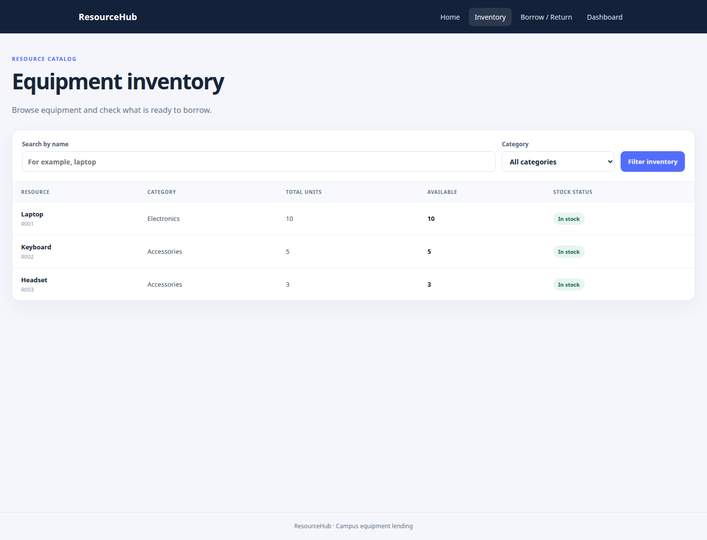
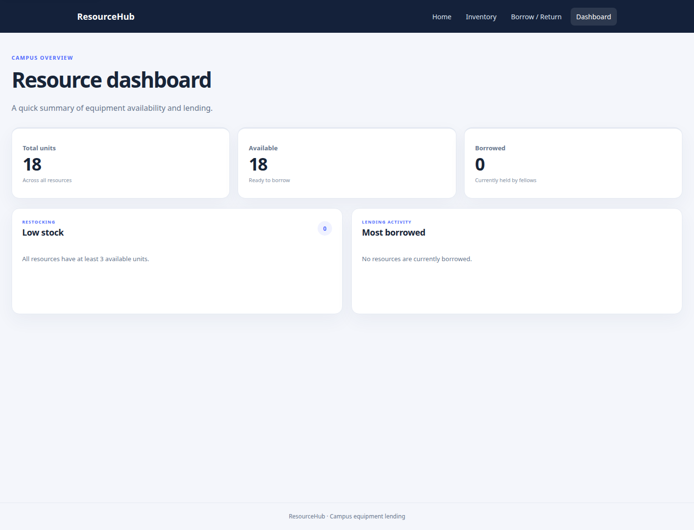

# ResourceHub

ResourceHub is a campus equipment lending project. The command-line program
uses Python's standard library and SQLite. A separate Flask website provides
an inventory, borrow and return forms, and a dashboard.

## Screenshots

### Inventory



### Dashboard



## Run the command-line program

```sh
python3 main.py
```

SQLite saves data in `campus_resources.db` in the directory where you start
the program. A new database starts with sample resources and fellows. Loans are
due in 14 days by default; reports include overdue items and the fellow holding
them. Choose **Export report to CSV** to create `report.csv`.

## Run the Flask website locally

From the project folder, create and activate a virtual environment:

```sh
python3 -m venv .venv
source .venv/bin/activate
```

On Windows PowerShell, activate it with:

```powershell
.venv\Scripts\Activate.ps1
```

Install the packages and start the website:

```sh
python -m pip install -r requirements.txt
python app.py
```

Open <http://127.0.0.1:5000>. Stop the server with **Ctrl+C**. The Flask
website uses the same `campus_resources.db` as the command-line program, so
run it from the project folder to use the project's database.

## Digital vendor website

Run the digital vendor website with:

```sh
python web_app.py
```

Open <http://127.0.0.1:8000>. Companies can register their own shop accounts.
Each shop has its own SQLite inventory database, owner account, company contact
information, reports, and staff. Owners manage staff for their shop; staff can
record its sales, loans, and returns. Existing single-shop data remains in the
original database as the `default` shop.

By default, the website stores its SQLite database, `auth.json`, and `backups/`
in the directory from which it starts. For hosting, point all persistent data
at the host's mounted persistent volume:

```sh
export RESOURCEHUB_DATA_DIR="/path/to/persistent/volume"
export RESOURCEHUB_HOST="0.0.0.0"
export PORT="8000"
python web_app.py
```

`RESOURCEHUB_DATA_DIR` holds the account registry, the original `default` shop
database, separate databases and backups for registered shops, and shared
backups together.
The app snapshots the database before inventory changes and saves a daily
snapshot; changes to accounts preserve the prior account file. Owners can also
download a ZIP backup from Reports. Keep a copy outside the server because
local snapshots are lost if the persistent volume is lost. The ZIP contains
shop records and password hashes, so keep it private.

Public company registration requires a sending email account and Cloudflare
Turnstile keys. For Gmail, create a Google App Password for the account that
will send verification codes. Copy [.env.example](/home/student/management-system/.env.example)
to `.env` in `RESOURCEHUB_DATA_DIR`, then replace the sender address, app
password, and Turnstile keys. The signup email is sent to the address entered
by each user. Keep `.env` private; it is ignored by Git.

The Gmail SMTP settings use `smtp.gmail.com` on port `587` by default, so only
the sender account values are needed in `.env`:

```sh
cp .env.example .env
chmod 600 .env
```

The signup flow verifies the company email and uses Turnstile. It collects a
company phone number but does not send phone verification codes. Use a host
with persistent disk mounted at `RESOURCEHUB_DATA_DIR`, and put the website
behind HTTPS for public access. The app listens on `PORT` and can bind to the
public interface with `RESOURCEHUB_HOST=0.0.0.0`. A free ephemeral filesystem
is suitable only for a demo; its database and account data can be lost on
restart or redeploy.

The `RESOURCEHUB_SECRET_KEY` setting below applies only to the separate Flask
starter (`app.py`), not the digital vendor website (`web_app.py`). The vendor
website keeps sessions in memory and uses HttpOnly, same-site cookies. A server
restart signs users out but does not erase inventory or account files. If
serving through an HTTPS reverse proxy, set `RESOURCEHUB_COOKIE_SECURE=1` so
browsers send the session cookie only over HTTPS.

For a stable Flask session key, set `RESOURCEHUB_SECRET_KEY` before starting
`app.py`. Generate a value with:

```sh
python -c "import secrets; print(secrets.token_hex(32))"
```

Then set that value in your shell as `RESOURCEHUB_SECRET_KEY`. Keep it private
and do not commit it. If it is not set, the app makes a temporary random key;
forms can stop working after the server restarts.

For example, on macOS or Linux:

```sh
export RESOURCEHUB_SECRET_KEY="paste-your-generated-value-here"
```

In Windows PowerShell:

```powershell
$env:RESOURCEHUB_SECRET_KEY = "paste-your-generated-value-here"
```

## Flask starter deployment demo

1. Push this project to a GitHub or GitLab repository.
2. In Render, create a **New Web Service** and connect that repository.
3. Choose the free instance type.
4. Set **Build Command** to `pip install -r requirements.txt`.
5. Set **Start Command** to `gunicorn app:app`. This deploys the Flask starter,
   not the digital vendor website described above.
6. Add an environment variable named `RESOURCEHUB_SECRET_KEY`. Generate a
   private value with the command above and paste it into Render's environment
   settings. Do not put the value in this README or source code.
7. Create the service. When deployment finishes, open its `onrender.com` URL.

This starter deployment is for demonstration. The free web service has an
ephemeral filesystem, so SQLite records can be lost on restart or redeploy.
Keeping real records requires a persistent database or a host that mounts
persistent storage. For the digital vendor website, run `python web_app.py`
with `RESOURCEHUB_DATA_DIR` pointed at that persistent volume as described
above, and place it behind HTTPS.

The deployment commands follow Render's [official Flask deployment guide](https://render.com/docs/deploy-flask).
See Render's [free instance details](https://render.com/docs/free) for current
limits and storage behavior.

## Tests

Run the command-line unit tests with:

```sh
python3 -m unittest
```
